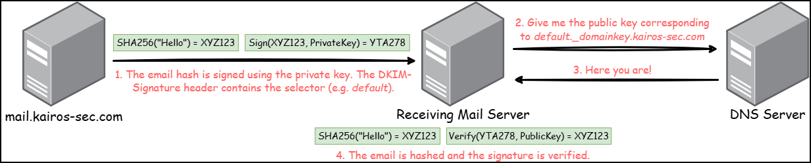

# DKIM check

DomainKeys Identified Mail (DKIM) signs selected message headers and body
content using a private key. A receiving system uses a public key in DNS to
verify the signature. A signature identifies its signing domain with `d=`
and selects a key with `s=`.



This simplified diagram is from [Email Security Explained](https://mollysec.com/posts/email-security-explained/).
Actual DKIM verification uses canonicalised headers and body data rather than
a single hash of the whole email.

## What Email Audit checks

The tool queries each selector in a small list of common selectors at
`<selector>._domainkey.<target-domain>`. With an email sample, it also queries
the extracted selector against the signature's `d=` signing domain. A usable
RSA or Ed25519 public key is marked present; a revoked, malformed or unsupported
key is inconclusive. The sample's signing domain may be different from the
target, in which case its key is reported separately.

```text
selector1._domainkey.example.com TXT "v=DKIM1; k=rsa; p=<public-key>"
```

| DNS field | Meaning |
|---|---|
| `v=DKIM1` | Identifies the DKIM version. |
| `k=rsa` | Specifies the public-key algorithm; RSA is the default when omitted. |
| `p=` | Contains the public key used to verify signatures. |

The corresponding `DKIM-Signature` header may include:

| Header field | Meaning |
|---|---|
| `a=` | Signature algorithm. |
| `d=` | Signing domain. |
| `s=` | Selector used to locate the public key. |
| `h=` | Headers included in the signature. |
| `bh=` | Hash of the canonicalised message body. |
| `b=` | Digital signature. |

If available, the sample's reported `dkim` authentication result is shown as
additional evidence. A published key alone does not demonstrate that
messages are signed or that a signature passes validation.

For a discovered RSA key, the public key is decoded and its modulus length is
measured. A key below 2048 bits produces `weak-dkim-rsa-key`. A 2048-bit or
larger key does not produce that finding.

Missing, revoked, malformed or non-RSA keys do not produce a weak RSA finding.
A key that cannot be validated is reported separately; Ed25519 keys are not
subject to the RSA key-length check.

## Limitations

Selectors can have arbitrary names, and discovery is not exhaustive. The
primary DKIM assessment prefers a usable discovered key. Weak RSA keys and
unvalidated keys found in the other common selectors are also reported.

The sample lookup uses the first signature's selector and signing domain.
This is not a complete inventory of signing keys.

Signature validity and DMARC alignment are not independently verified. An 
unknown result is not proof that DKIM is absent.

## References

- [RFC 6376: DKIM signatures](https://datatracker.ietf.org/doc/html/rfc6376)
- [RFC 8301: DKIM cryptographic requirements](https://datatracker.ietf.org/doc/html/rfc8301)
- [Email Security Explained](https://mollysec.com/posts/email-security-explained/)
