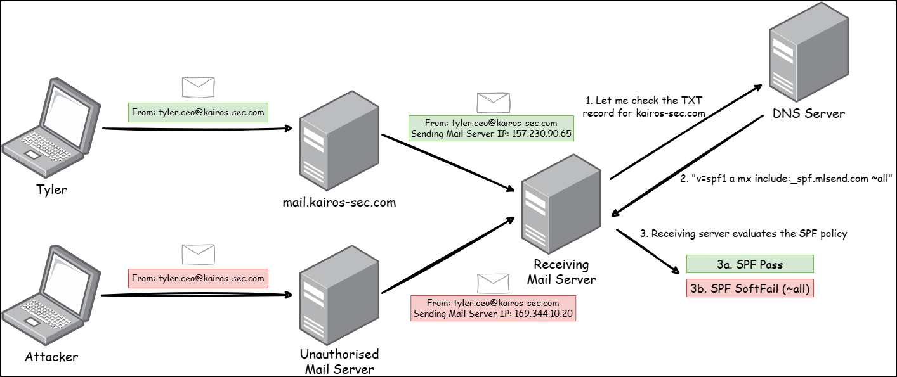

# SPF check

Sender Policy Framework (SPF) lets a domain publish which sending IP addresses
may use an SMTP identity. A receiver evaluates the record against the
connecting IP; SPF does not sign a message or verify its visible `From:`
header by itself.



This illustration is from [Email Security Explained](https://mollysec.com/posts/email-security-explained/);
the addresses are placeholders. SPF checks the SMTP envelope sender or HELO
identity, not the visible `From:` header.

## What Email Audit checks

The tool queries the target domain's TXT records for SPF records beginning
with `v=spf1`. It displays recognised mechanisms and classifies the first
`all` mechanism. Multiple SPF records and invalid IP mechanisms are
inconclusive. An earlier `ip4:` or `ip6:` mechanism that permits an entire
address family is flagged as insecure, even if followed by `-all`.

A failed lookup is inconclusive; a genuinely absent record is marked missing.

```text
v=spf1 ip4:192.0.2.10 include:mail.example.net -all
```

| Component | Meaning |
|---|---|
| `v=spf1` | Identifies the SPF version. |
| `ip4:` / `ip6:` | Matches a sending IPv4 / IPv6 address or range. |
| `include:` | Matches senders permitted by another domain's SPF policy. |
| `all` | Matches any sender reaching this mechanism. |

| Value | Behaviour | Use case | Assessment |
|---|---|---|---|
| `-all` | SPF fail for senders not matched earlier | Domains with a fully identified sending infrastructure | Secure |
| `~all` | SPF softfail for senders not matched earlier | Sending sources are not yet fully known | Acceptable |
| `+all` or `all` | SPF pass for all remaining senders | Testing, backwards compatibility, or misconfiguration | Insecure |
| `?all` | SPF neutral for senders not matched earlier | No definitive policy for remaining senders | Unknown |

An unqualified `all` is equivalent to `+all`; mechanisms after the first
`all` are ignored. SPF returns an authentication result; recipients decide
whether to reject or otherwise handle a message.

## Limitations

This is a simple record review, not a complete SPF evaluator. It does not
resolve all mechanisms, calculate the DNS lookup limit, or establish that a
specific sender will pass. A secure classification of `-all` does not validate
the whole policy. Check the full policy
independently and retry inconclusive DNS lookups. A sample's reported SPF result
reflects that message's receiving system, not a new verification.

## References

- [RFC 7208: Sender Policy Framework](https://datatracker.ietf.org/doc/html/rfc7208)
- [Email Security Explained](https://mollysec.com/posts/email-security-explained/)
